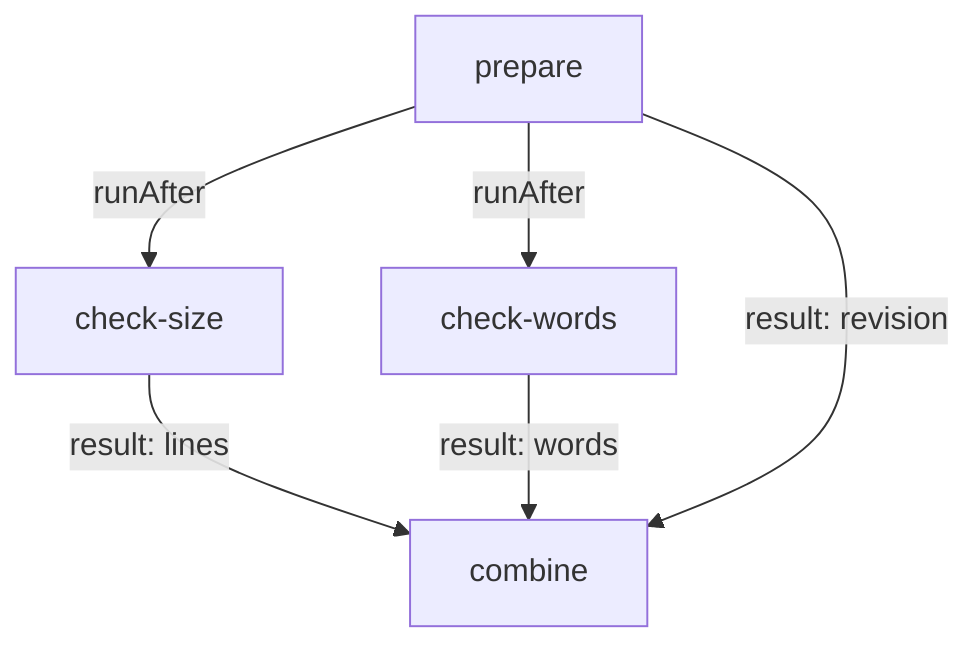

# Order Tasks Into A Graph And Read The Run

A Pipeline with two tasks has only two possible orders. A real Pipeline has many tasks, and the order matters twice. Tasks that depend on each other must wait, or they read missing data. Tasks that do not depend on each other should run at the same time, or the Pipeline is slower than it needs to be. This part shows how Tekton works out the order, what goes wrong when a dependency is missing, and how to read a `PipelineRun` to prove the order it really used.

## Two kinds of edges

Tekton turns the pipeline tasks into a directed acyclic graph (DAG): a graph whose edges point in one direction and never form a loop. A pipeline task with no incoming edge starts as soon as the `PipelineRun` starts. A pipeline task with incoming edges starts when every task it depends on has finished. There are two ways to draw an edge:

- **An ordering dependency:** `runAfter: [<task>, ...]`. The task waits, but no value travels.
- **A resource dependency:** a reference to a result of another task, such as `$(tasks.prepare.results.revision)`, in `params` or in a `when` expression. The task waits because it needs the value.

Anything else is not an edge. In particular, two tasks that use the same workspace are not ordered by that fact alone. If one task writes a file and another reads it, and nothing else connects them, Tekton starts both at once and the reader may look before the writer has written.

## Build a graph with a parallel branch

The Pipeline below has four tasks. `prepare` writes a file into the workspace and publishes the result `revision`. `check-size` and `check-words` both read that file, so they `runAfter` `prepare`. They do not depend on each other, so they run side by side. `combine` takes one result from each check, which makes it wait for both. Every task uses an embedded `taskSpec`, a Task written straight into the pipeline task, to keep the example in one file.

<!-- astrona:playground:renew -->

Save this as `pipeline-diamond.yaml`:

```yaml
apiVersion: tekton.dev/v1
kind: Pipeline
metadata:
  name: diamond
  namespace: starfleet
spec:
  workspaces:
    - name: data
  results:
    - name: report
      value: $(tasks.combine.results.report)
  tasks:
    - name: prepare
      workspaces:
        - name: data
          workspace: data
      taskSpec:
        workspaces:
          - name: data
        results:
          - name: revision
        steps:
          - name: prepare
            image: busybox:1.37.0
            script: |
              #!/bin/sh
              set -eu
              printf 'bridge online\nscout online\n' > "$(workspaces.data.path)/status.txt"
              printf 'rev-1' > "$(results.revision.path)"
    - name: check-size
      runAfter:
        - prepare
      workspaces:
        - name: data
          workspace: data
      taskSpec:
        workspaces:
          - name: data
        results:
          - name: lines
        steps:
          - name: count
            image: busybox:1.37.0
            script: |
              #!/bin/sh
              set -eu
              sleep 5
              printf '%s' "$(wc -l < "$(workspaces.data.path)/status.txt" | tr -d ' ')" > "$(results.lines.path)"
    - name: check-words
      runAfter:
        - prepare
      workspaces:
        - name: data
          workspace: data
      taskSpec:
        workspaces:
          - name: data
        results:
          - name: words
        steps:
          - name: count
            image: busybox:1.37.0
            script: |
              #!/bin/sh
              set -eu
              sleep 5
              printf '%s' "$(wc -w < "$(workspaces.data.path)/status.txt" | tr -d ' ')" > "$(results.words.path)"
    - name: combine
      params:
        - name: revision
          value: $(tasks.prepare.results.revision)
        - name: lines
          value: $(tasks.check-size.results.lines)
        - name: words
          value: $(tasks.check-words.results.words)
      taskSpec:
        params:
          - name: revision
          - name: lines
          - name: words
        results:
          - name: report
        steps:
          - name: combine
            image: busybox:1.37.0
            script: |
              #!/bin/sh
              printf '%s: %s lines, %s words' "$(params.revision)" "$(params.lines)" "$(params.words)" > "$(results.report.path)"
```

The graph Tekton builds from this file looks like this:



The two checks form a parallel branch, and `combine` waits for every task whose result it uses.

Apply the Pipeline and start it:

```sh
kubectl apply -f pipeline-diamond.yaml
tkn pipeline start diamond -n starfleet -w name=data,volumeClaimTemplateFile=workspace-template.yaml --showlog
```

The `-w` flag reads a claim template from the file `workspace-template.yaml`. If that file is not in your folder yet, save it with this content and run the command again:

```yaml
spec:
  accessModes:
    - ReadWriteOnce
  resources:
    requests:
      storage: 16Mi
```

## Prove the order from the TaskRuns

The log shows that both checks ran, but not when. The times are in the TaskRuns. Each TaskRun has `status.startTime`, set when the controller picks it up, and `status.completionTime`, set when it ends. The labels connect each TaskRun to its run and its pipeline task, so one `kubectl` command shows the whole graph in time order.

Copy the generated name of the run (`tkn pipelinerun list -n starfleet` shows it) and use it in place of `<RUN>`:

```sh
kubectl get taskruns -n starfleet -l tekton.dev/pipelineRun=<RUN> --sort-by=.status.startTime -o custom-columns='TASK:.metadata.labels.tekton\.dev/pipelineTask,START:.status.startTime,END:.status.completionTime,REASON:.status.conditions[0].reason'
```

`prepare` comes first. `check-size` and `check-words` have start times within a second or two of each other, and each of them starts after `prepare` ended. `combine` starts after both checks ended. That is the proof that a graph is right: every task starts at or after the end of the tasks it depends on, and independent tasks overlap.

## When one task fails

A graph also decides what happens on failure. When a pipeline task fails, the controller stops the `PipelineRun`: tasks that are already running finish, but tasks that have not started yet are not started. They are listed under `status.skippedTasks` with the reason `PipelineRun was stopping`, and the `PipelineRun` ends with `Succeeded` `False` and the reason `Failed`.

Before any TaskRun exists, the controller also checks the run against the Pipeline and its Tasks. These checks give the `PipelineRun` a reason of its own and leave no TaskRuns at all:

| Reason | What is wrong |
| --- | --- |
| `InvalidWorkspaceBindings` | The `PipelineRun` does not bind a workspace that the `Pipeline` declares |
| `ParameterMissing` | The `PipelineRun` does not give a value for a Pipeline parameter without a default |
| `PipelineValidationFailed` | A pipeline task does not pass a value for a Task parameter without a default, among other checks |
| `InvalidTaskResultReference` | A pipeline task refers to a result that the Task does not declare |
| `CouldntGetTask` / `CouldntGetPipeline` | A referenced Task or Pipeline does not exist |

The webhook catches a few graph errors even earlier, when you apply the `Pipeline`: a `runAfter` that names a pipeline task that does not exist, or edges that form a loop. Then the `kubectl apply` fails and nothing is stored.

You can now build a graph from `runAfter` and result references, and prove its order from the start and end times of the TaskRuns. You can also tell a failure in a task, which leaves TaskRuns and skipped tasks, from a failure of the run itself, which leaves none. The open question for later is how to skip a task on purpose and how to run clean-up work even after a failure.

## Common pitfalls

> [!WARNING]
> - **Relying on a shared workspace for order.** A file in a workspace is not an edge. Add `runAfter` or pass a result.
> - **Chaining tasks that could run in parallel.** An extra `runAfter` costs time on every run. Only add edges for real dependencies.
> - **Reading the order from the list of tasks.** The order in `spec.tasks` means nothing; only the edges count.
> - **Looking for logs of a validation failure.** Reasons such as `InvalidWorkspaceBindings` mean no TaskRun was created. Read the condition message.
> - **Thinking a stopped run cancels running tasks.** Tasks already running finish; only tasks not yet started are skipped.

## Your mission: Fix The Task Graph Of A Pipeline

You can now read a failed `PipelineRun`, find the result reference or the edge that is wrong, and prove the order of a graph from its TaskRuns. The graded lab gives you a Pipeline that fails twice in a row for two different reasons, and asks you to fix it until its PipelineRun succeeds with the right pipeline result and the right order.

The lab runs in its own cluster, so first pause your playground. Nothing in it is lost:

```sh
astrona stop ats-126-playground-010-01
```

Then start the lab:

```sh
astrona run --git ssh://git@github.com/astrona-io/ATS126.git -c sections/section-010/module-01/labs/lab-01
```

The task is on the next page. Solve it on your own first. When you think you are done, send it for grading:

```sh
astrona submit -c sections/section-010/module-01/labs/lab-01
```

When the lab is done, remove it and start your playground again:

```sh
astrona destroy ats-126-lab-010-01
astrona start ats-126-playground-010-01
```
