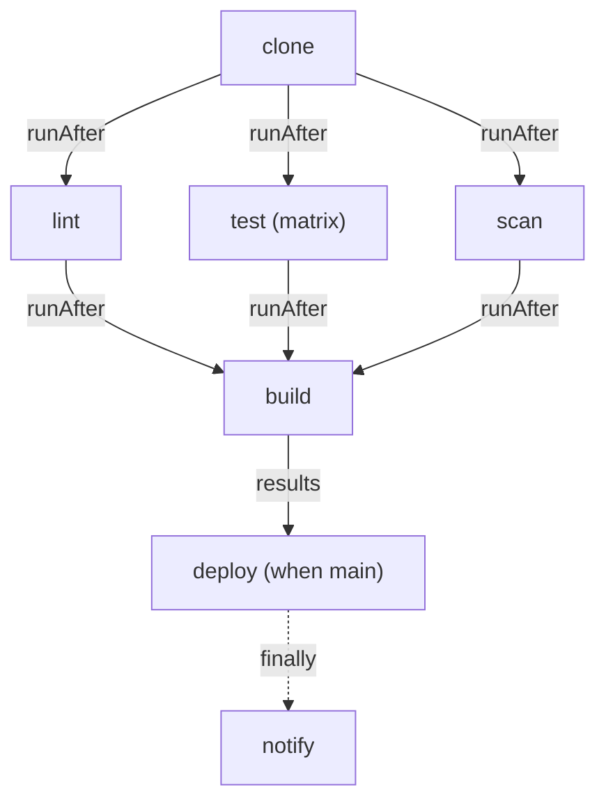

# Design An End-To-End CI Pipeline

A CI pipeline has two jobs that pull in opposite directions. It must be safe: nothing reaches production unless it was checked, tested, scanned and built from the right branch, and every failure is reported. And it must be fast, because developers wait for it on every push. A good Tekton Pipeline gets both from its graph: checks run in parallel, the build waits for all of them, the deploy is guarded, and the report sits in `finally`. This part designs that graph for the `bridge` application and runs it against the Gitea server and the registry in your playground.

## The graph

Seven Tasks are ready in `starfleet`. `git-clone` fetches one branch, `shellcheck` checks the shell scripts with ShellCheck, `unit-test` runs `test.sh` in the image from its parameter `image`, and `secret-scan` fails on lines that assign a password, token or secret. That last one is a stand-in for a real scanner such as a vulnerability or secret scanner: it is a `grep`, honest but simple. `build-image` builds the `Dockerfile` with kaniko, a tool that builds images inside a normal container, without a Docker daemon, and pushes the image. `deploy` records a release in the ConfigMap `bridge-release`, and `notify` writes the outcome of a run to a ConfigMap; both stand in for a real rollout and a real chat message. Read any of them with `kubectl get task <name> -n starfleet -o yaml`.

From the jobs, the graph follows:



The three checks only need the source, so they run in parallel after `clone`. `build` waits for all three, because an image that failed a check must not be pushed. `deploy` uses the results of `build` and runs only for `main`. `notify` runs in `finally`, after everything else, whatever happened.

## The checks: clone, lint, test and scan

Start with the first half of the graph. All tasks share one workspace, `source`, which a `volumeClaimTemplate` turns into a fresh volume per run. The tag of the image will be the short commit hash, a result of `clone`.

<!-- astrona:playground:renew -->

Save this as `pipeline-bridge-ci.yaml`:

```yaml
apiVersion: tekton.dev/v1
kind: Pipeline
metadata:
  name: bridge-ci
  namespace: starfleet
spec:
  params:
    - name: repo-url
      type: string
      default: http://gitea-http.gitea.svc.cluster.local:3000/starfleet/bridge.git
    - name: branch
      type: string
      default: main
    - name: image
      type: string
      default: registry.registry.svc.cluster.local:5000/starfleet/bridge
  workspaces:
    - name: source
  tasks:
    - name: clone
      taskRef:
        name: git-clone
      params:
        - name: url
          value: $(params.repo-url)
        - name: revision
          value: $(params.branch)
      workspaces:
        - name: output
          workspace: source
    - name: lint
      runAfter:
        - clone
      taskRef:
        name: shellcheck
      workspaces:
        - name: source
          workspace: source
    - name: test
      runAfter:
        - clone
      taskRef:
        name: unit-test
      matrix:
        params:
          - name: image
            value:
              - busybox:1.37.0
              - alpine:3.22.7
      workspaces:
        - name: source
          workspace: source
    - name: scan
      runAfter:
        - clone
      taskRef:
        name: secret-scan
      workspaces:
        - name: source
          workspace: source
```

Save the run as a file too. It uses the ServiceAccount `ci-bot` for all its TaskRuns, through `taskRunTemplate`, because `deploy` and `notify` will need its permission to write ConfigMaps.

Save this as `pipelinerun-bridge-ci.yaml`:

```yaml
apiVersion: tekton.dev/v1
kind: PipelineRun
metadata:
  generateName: bridge-ci-
  namespace: starfleet
spec:
  pipelineRef:
    name: bridge-ci
  params:
    - name: branch
      value: main
  taskRunTemplate:
    serviceAccountName: ci-bot
  workspaces:
    - name: source
      volumeClaimTemplate:
        spec:
          accessModes:
            - ReadWriteOnce
          resources:
            requests:
              storage: 64Mi
```

Apply the Pipeline and create a run (`kubectl create`, because of `generateName`):

```sh
kubectl apply -f pipeline-bridge-ci.yaml
kubectl create -f pipelinerun-bridge-ci.yaml
tkn pipelinerun logs --last -f -n starfleet
```

The log shows `clone` cloning `main`, ShellCheck finding no problems, `test.sh` passing twice, once per image, and the scan finding no secrets. The four TaskRuns after `clone` start within a few seconds of each other.

## The build, the guarded deploy and the report

Now add the second half. Each piece is a plain pipeline task with fields you have seen before; together they finish the graph. Add these entries to `spec.tasks` of `pipeline-bridge-ci.yaml`, after `scan`. `build` waits for the three checks with `runAfter`, and tags the image with the short commit. `deploy` takes the image URL and digest from `build`, so it waits for it, and its `when` expression lets it run only for `main`:

```yaml
    - name: build
      runAfter:
        - lint
        - test
        - scan
      taskRef:
        name: build-image
      params:
        - name: image
          value: $(params.image)
        - name: tag
          value: $(tasks.clone.results.short-commit)
      workspaces:
        - name: source
          workspace: source
    - name: deploy
      when:
        - input: $(params.branch)
          operator: in
          values:
            - main
      taskRef:
        name: deploy
      params:
        - name: image-url
          value: $(tasks.build.results.IMAGE_URL)
        - name: image-digest
          value: $(tasks.build.results.IMAGE_DIGEST)
        - name: commit
          value: $(tasks.clone.results.commit)
```

Then add a `finally` list at the level of `spec.tasks`. The report takes only the run name, the branch and execution status, never a result, so it also runs when the build fails:

```yaml
  finally:
    - name: notify
      taskRef:
        name: notify
      params:
        - name: pipelinerun
          value: $(context.pipelineRun.name)
        - name: branch
          value: $(params.branch)
        - name: status
          value: $(tasks.status)
        - name: deploy-status
          value: $(tasks.deploy.status)
```

`$(context.pipelineRun.name)` is a context variable: Tekton replaces it with the name of the run, so each run gets its own notification ConfigMap. Apply the Pipeline again and run it for `main`:

```sh
kubectl apply -f pipeline-bridge-ci.yaml
kubectl create -f pipelinerun-bridge-ci.yaml
```

Then change `value: main` in `pipelinerun-bridge-ci.yaml` to `value: feature/banner` and run `kubectl create -f pipelinerun-bridge-ci.yaml` once more. The two runs can work at the same time; each gets its own volume.

## Read the outcome

Wait until both runs have ended (`tkn pipelinerun list -n starfleet`), then look at what they left behind:

```sh
kubectl get --raw /api/v1/namespaces/registry/services/registry:http/proxy/v2/starfleet/bridge/tags/list; echo
kubectl get configmap bridge-release -n starfleet -o jsonpath='{.data}'; echo
kubectl get configmaps -n starfleet
```

The registry lists one tag per built commit: `main` and `feature/banner` have different commits, so there are two tags. `bridge-release` names the image of `main` only, with its digest and commit: the run on `feature/banner` built and pushed its image, but its `deploy` was skipped with `When Expressions evaluated to false`, and that run ended `Completed`. Each run has a ConfigMap `ci-notification-<run>`; the one for `main` says `status: Succeeded`, `deploy: Succeeded`, and the one for `feature/banner` says `status: Completed`, `deploy: None`.

The real test of a CI pipeline is a bad commit. The branch `broken` adds a script that ShellCheck rejects. A run on it fails in `lint`; `build` and `deploy` are skipped with `PipelineRun was stopping`, nothing is pushed, and `notify` still writes `status: Failed`. Try it with `value: broken` in the run file.

You now have a complete CI pipeline: parallel checks, a matrix of tests, an image built and pushed from inside the cluster, a deploy only from `main`, and a report on every run. Every decision it makes is visible in the status of its `PipelineRun`.

## Common pitfalls

> [!WARNING]
> - **Building before all checks pass.** `build` needs `runAfter` on every check; a result reference to only one of them is not enough.
> - **Giving the report a result of `build`.** After a failed check, `build` never runs and `notify` is skipped with `Results were missing`.
> - **Forgetting the ServiceAccount.** Without `taskRunTemplate.serviceAccountName: ci-bot`, `deploy` and `notify` run as `default` and cannot write ConfigMaps.
> - **Tagging images with the branch name.** Branch names can contain `/`, which is not allowed in a tag, and a branch moves; a commit hash does not.
> - **Treating the plain HTTP registry as normal.** `--insecure` in `build-image` is for this lab only; a real registry uses TLS.

## Your mission: Build An End-To-End CI Pipeline

You can now design a CI Pipeline as a graph, fan tests out with a matrix, build and push an image, deploy only from `main`, and report every run from `finally`. The graded lab gives you the same Tasks and a Pipeline that only clones and lints, and asks you to complete it and prove it with runs on `main`, on a feature branch and on a broken branch.

The lab runs in its own cluster, so first pause your playground. Nothing in it is lost:

```sh
astrona stop ats-126-playground-030-01
```

Then start the lab:

```sh
astrona run --git ssh://git@github.com/astrona-io/ATS126.git -c sections/section-030/module-01/labs/lab-01
```

The task is on the next page. Solve it on your own first. When you think you are done, send it for grading:

```sh
astrona submit -c sections/section-030/module-01/labs/lab-01
```

When the lab is done, remove it and start your playground again:

```sh
astrona destroy ats-126-lab-030-01
astrona start ats-126-playground-030-01
```
